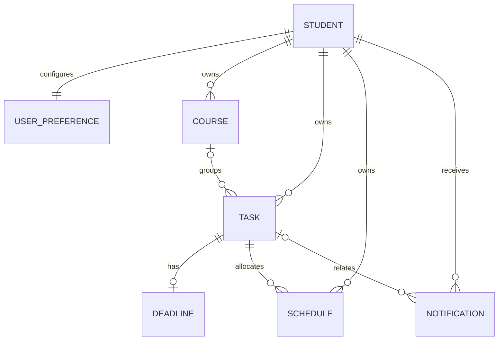

# Technical design

## Three tiers

The browser renders Jinja shells, then ES-module JavaScript loads JSON using Fetch with same-origin cookies and CSRF headers. Flask owns validation and all business rules. SQLAlchemy persists data in SQLite. Blueprints separate account endpoints from private academic endpoints; planning and reminder logic lives in services rather than templates.

## Database

| Table | Key and relationships | Integrity and indexes |
|---|---|---|
| student | integer ID | unique normalized email; non-null name/password hash |
| user_preference | student_id PK/FK, one per student | cascading account delete; positive daily hours constraint |
| course | ID; student_id FK | unique (student_id, code); indexed owner |
| task | ID; student_id FK; optional course_id FK | status/priority/type/effort checks; indexes on owner/status and course |
| deadline | ID; unique task_id FK | one canonical due_at per task; indexed date; cascade task delete |
| schedule | ID; student_id and task_id FKs | end > start; indexed owner/start/end and task; cascade task delete |
| notification | ID; student_id FK; optional task_id FK | unique (student_id, dedupe_key); indexed owner; task deletion retains history |
| web_session | SHA-256 token hash PK | JSON server-side data; indexed expiry |

Courses, tasks, schedules and notifications are always queried with the authenticated owner. Linked course/task IDs are separately ownership-checked. Client-supplied owner IDs are never assigned to records. Database foreign keys enforce record existence; account ownership is enforced at the service/API boundary. An operations user with direct SQL access must preserve ownership consistency.

Numeric entity IDs use SQLite AUTOINCREMENT so deleted IDs are not reused in notification deduplication keys.

All stored datetimes are UTC-naive for portable DATETIME storage; serializers append `Z`. Datetime inputs require ISO 8601 with a timezone. Preferences use IANA ZoneInfo, with tzdata bundled as a Python dependency for Windows. Schedule boundaries are converted into the student's timezone for availability checks.

## Priority algorithm

For each incomplete task, let H be hours to deadline, E be estimated effort (1h if absent), and I be importance: low=0.2, medium=0.6, high=1.

- U = 0 without a deadline; 1 when H ≤ 0; otherwise 1 / (1 + H / 24).
- P = 0 without a deadline; otherwise min(1, E / max(H, 1)).
- Score = 100 × (0.55U + 0.30I + 0.15P), rounded to two decimals.

`PRIORITY_WEIGHTS` in the factory configuration is the configurable weight tuple. Keep weights non-negative and summing to 1 when changing it. Sorting uses descending score, then deadline and ID for deterministic ties. At risk means effort exceeds nonnegative time remaining, an intentionally conservative elapsed-time heuristic. Scheduling capacity provides a separate feasibility check. Significant effort means at least 4h. Completed tasks are excluded. Scores explain urgency, importance, effort and missing-estimate assumptions; no AI/ML claim is made.

## Workload semantics

Remaining effort is the sum of known estimates of incomplete tasks; missing estimates are counted explicitly. Daily planned workload is the sum of scheduled durations of incomplete tasks on each local date. Sessions crossing local midnight are split across dates when summarizing imported/historical records. The API only permits new same-day sessions.

Weekly workload is the sum of the seven daily values. Preferred daily capacity is the saved daily-hours threshold on available weekdays, zero on unavailable weekdays. The study window is an additional hard scheduling constraint; a narrow window may make less time schedulable than the preferred daily threshold. Workload by course and importance sums incomplete task estimates. Completed tasks and their sessions are excluded from active workload. Scheduled time is an allocation, not a deduction of actual completed effort; no timer or partial-effort ledger is implemented.

## Scheduling

Rank incomplete tasks. For each task, subtract already allocated session durations from its estimate (or the explicit 1h assumption). Search available weekdays across a 30-day horizon. Start no earlier than now, initially rounded to a 15-minute grid. Cap each proposed block at one hour, the remaining estimate, the day's remaining capacity, the next existing activity, the study-window end and the deadline. Large tasks can span days. A missing deadline uses the horizon boundary. Existing calendar activities remain reserved; completed task events are historical and can be removed to free a slot.

Suggestions are read-only. Unallocated effort is returned with an explanation. The student selects sessions or discards the proposal. Acceptance runs in a SQLite write transaction, validates each session against current data, flushes within one transaction, and commits all selected sessions together. A stale or conflicting proposal fails without saving a partial plan. Manual create/update uses the same validator and transaction reservation. Task/deadline changes use the same reservation and reject changes that invalidate existing sessions.

SQLite file connections use foreign keys, WAL mode, a 30-second busy timeout and SQLAlchemy-controlled transactions. Every transaction starts with **BEGIN IMMEDIATE**, before session lookup or validation reads. This reserves SQLite's single writer slot across threads and processes and prevents stale read-to-write upgrades. Session persistence also writes on GET, so read requests use this same conservative reservation. Competing requests wait and validate after the previous transaction commits; tests cover four competing threads and four competing processes, with exactly one successful slot booking.

This favors correctness for the academic workload over parallel read throughput. Keep the database on one host's local filesystem. Do not place it on a network share, run copies on multiple hosts, or assume horizontal scaling. Use SQLite's backup API for live backups.

## Reminders

`flask --app run reminders` iterates students and runs independently of browser traffic. For incomplete dated tasks it generates an overdue alert or the nearest configured upcoming interval that has been reached. Keys include task ID, deadline timestamp and interval, so the same alert is emitted once. Changed deadlines produce a new key. Overload alerts cover the next 30 local dates and include date, workload and capacity in their keys. The SQLite transaction reservation serializes reminder generation with academic writes; unique keys provide a second guard. Completing a task marks its existing reminders read and suppresses future deadline generation. History remains available.

## Security

Werkzeug scrypt password hashes; normalized unique emails; current-password verification for credential changes; Flask-Login; a random opaque 48-byte session token in an HTTP-only SameSite=Lax cookie. Only a SHA-256 token hash and JSON session contents are stored in SQLite. The token rotates after login and registration; logout deletes the server record. Password changes revoke other account sessions. Idle expiry defaults to 30 minutes. Expired rows can be removed with the purge CLI job.

Flask-Login uses its `basic` fingerprint protection. A User-Agent/IP change marks a session non-fresh instead of deleting the authenticated identity. Browser device emulation can change this fingerprint between document, CSRF and fetch requests; a fingerprint is not a stable device identifier. Current-password verification is still required to change account credentials, and server-side expiry, logout/password-change revocation, CSRF and ownership checks remain enforced. The policy is configured per application, so one factory instance cannot alter another instance's session policy.

Flask-WTF validates CSRF on all state-changing requests, including registration/login. The browser retrieves a token through `/api/auth/csrf` and sends `X-CSRFToken`. The app uses same-origin requests without permissive CORS. Flask-Limiter limits login/registration and general traffic; production startup requires shared Redis storage. SQLAlchemy parametrizes queries. Jinja autoescaping and the frontend escaping helper protect user content in HTML. CSP restricts scripts/connections to the same origin; local library assets avoid runtime third-party requests. HSTS and secure cookies are enabled in production. Nginx terminates HTTPS and limits request size. Logging includes internal exceptions server-side, while clients receive generic 500 responses.

External references checked during implementation: [Flask configuration](https://flask.palletsprojects.com/en/stable/config/), [Flask security](https://flask.palletsprojects.com/en/stable/web-security/), and [Flask-Login](https://flask-login.readthedocs.io/en/latest/).

## Operations

The run.py entry point calls app/startup.py before serving requests. Startup creates a persistent random secret when SECRET_KEY is absent and applies versioned upgrades under a cross-process OS file lock. Existing configuration, accounts and records are preserved; initialization never downgrades a schema or seeds a user. HTTP requests themselves never create tables. Back up SQLite, monitor health checks and logs, and run reminders/purge jobs. Linux serving uses Gunicorn behind Nginx; Windows uses Waitress. Production requires a strong secret, writable local SQLite storage, shared Redis rate limiting, HTTPS and a scheduled reminders job. Long-term availability, TLS provisioning, restored-backup verification and production tuning remain operator responsibilities.
